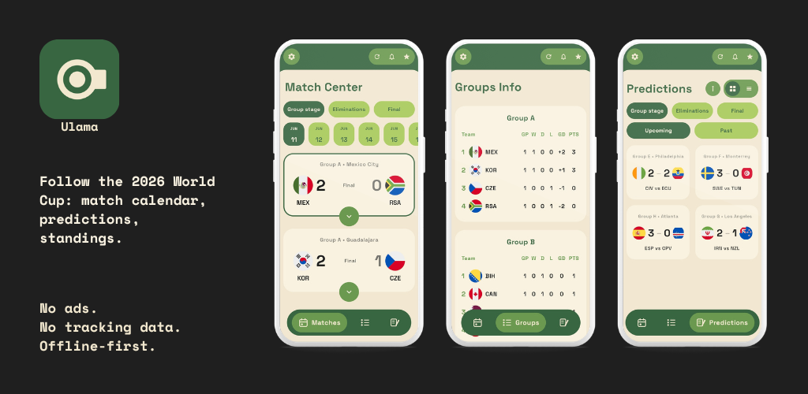
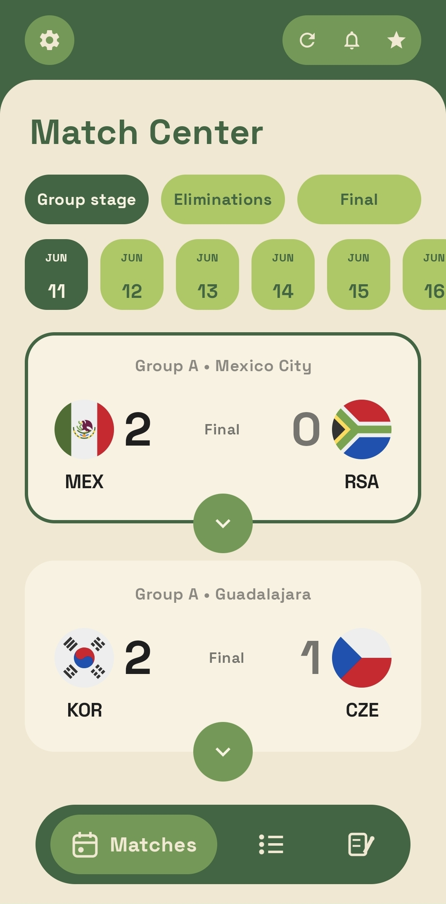
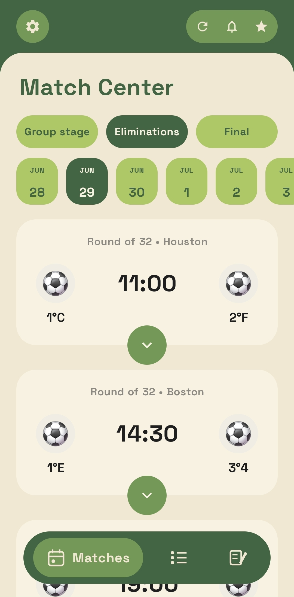
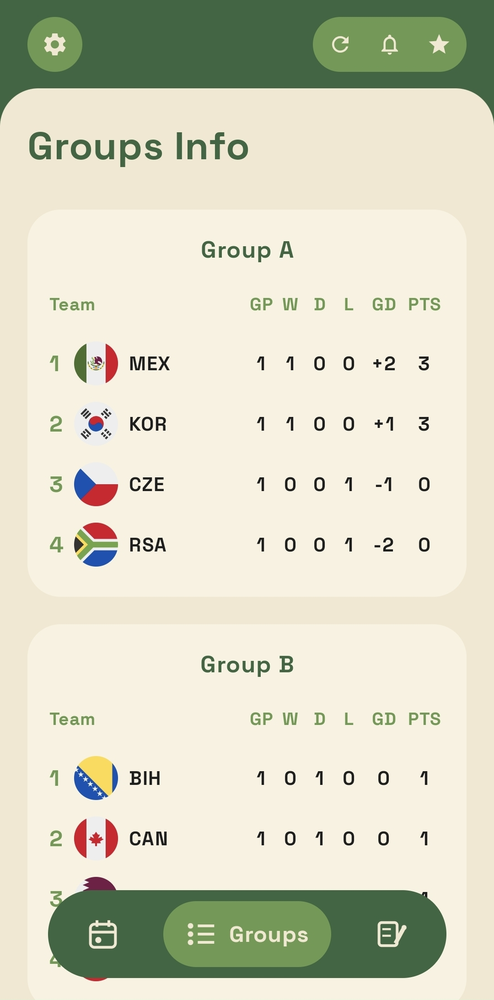
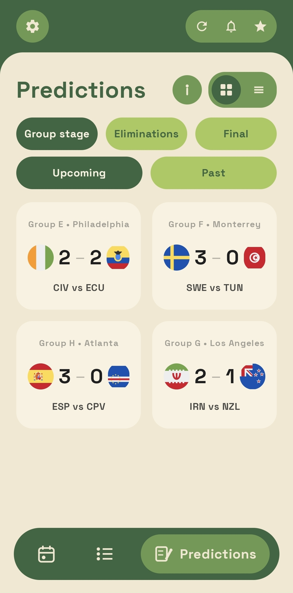

# Ulama - Live Football Tracker & Competitions

**Ulama** is a modern, clean, and privacy-focused football companion app for Android, built with Kotlin and Jetpack Compose. Designed around Material Design 3 Expressive, it delivers real-time match tracking, club and international league standings, tactical match details, and on-device live score notifications—all with zero ads, zero trackers, and complete privacy.

[](https://github.com/Ixeken-Studios/ulama-app/releases/latest)



---

## What's New in Version 2.0

> **A new era for Ulama** — The application has been redesigned from the ground up:

- **Beyond the World Cup:** Full support for major international leagues, domestic championships, club tournaments, dynamic standings tables, and tournament brackets.
- **Aesthetic Reimagination:** Refreshed visual design crafted with Material 3 Expressive, connected list groups, dynamic themes, and fluid organic motion.
- **Live Notifications & Now Bar:** Real-time on-device match tracking directly on your lock screen, notification shade, and Samsung One UI Now Bar without reliance on external servers.

---

## Key Features

### Match Center & Live Scores
- **Day-by-Day Calendar:** Fluid horizontal date picker to browse previous, ongoing, and upcoming fixtures across all supported competitions.
- **Real-Time Match Pulse:** Live score updates with animated pulsating indicators for in-play matches, halftime, and penalty shootouts.
- **Detailed Match Summary:** Tap any match to explore the timeline, live stats (possession, shots, fouls, corners), head-to-head records, venue information, and tactical pitch formations.

### Competitions & Radial Brackets
- **Comprehensive League Coverage:** Browse standings, fixtures, and club statistics for top domestic leagues (LaLiga, Premier League, Serie A, Bundesliga, Ligue 1, Liga MX, MLS, and more) and continental club tournaments.
- **Radial Knockout Brackets:** Interactive circular bracket visualization for tournament knockout stages, providing a quick, holistic view of progression from round of 16 to the final.

### On-Device Live Tracking & Now Bar
- **Lock Screen & Now Bar:** Follow match progress in real time directly from your status bar, notification center, and Samsung One UI Now Bar.
- **Autonomous Sync:** Powered by a foreground data synchronization service executing entirely on your device with no intermediary servers.
- **Pre-Match Reminders:** Configurable alarms (5 to 60 minutes before kickoff) scheduled via Android `AlarmManager` exact alarms.

### Personalization & Expressive Design
- **Material 3 Expressive:** Connected card groups, smooth spring animations, and tactile bounce feedback.
- **Color Themes & Contrast:** Select between dynamic palette styles and customize dark mode, light mode, or system default.
- **Favorite Teams & My Leagues:** Pin your favorite clubs and customize active tournaments to prioritize relevant matches at a glance.

### 100% Privacy & Offline Friendly
- **No Account Required:** Enjoy all features immediately with zero registration.
- **Zero Ads & Trackers:** No telemetry libraries, analytics, or third-party advertising SDKs.
- **Local Persistence:** All preferences and pinned selections are saved locally within your device sandbox using private preferences.

---

## Screenshots

<p align="center">
  
  
  
  
</p>

---

## Tech Stack

| Layer | Technology |
|---|---|
| **Language** | Kotlin 2.2 |
| **UI & Design** | Jetpack Compose, Material Design 3 Expressive (`1.5.0-alpha06`), Coil 3 |
| **Architecture** | Clean Architecture, MVVM, Unidirectional Data Flow, StateFlow |
| **Networking & API** | Retrofit 2.11, OkHttp 4.12, ESPN Public Endpoints |
| **Serialization** | Kotlinx Serialization JSON 1.7.3 |
| **Background Services** | Android Foreground Service (`dataSync`), Exact Alarms (`AlarmManager`) |
| **Tooling & Build** | AGP 9.4.1, Gradle Configuration Cache, R8 Full Mode Optimizations |

<p align="center">
  &nbsp;&nbsp;
  &nbsp;&nbsp;
  &nbsp;&nbsp;
  
</p>

---

## Requirements

To build and run Ulama locally, ensure you have:
- **Android Studio Meerkat** (2025.2) or newer.
- **JDK 17** or newer (bundled Android Studio JBR recommended).
- **Android SDK Platform 37** (Minimum SDK 35) installed via SDK Manager.

---

## Getting Started

### 1. Clone the repository
```bash
git clone https://github.com/Ixeken-Studios/ulama-app.git
cd ulama-app
```

### 2. Configure local environment
Create or verify your `local.properties` file with your Android SDK path (this file is excluded from Git):
```properties
sdk.dir=PATH_TO_YOUR_ANDROID_SDK
```

### 3. Build the application

- **Debug Build:**
  - *Linux/macOS:* `./gradlew assembleDebug`
  - *Windows:* `.\gradlew.bat assembleDebug`

- **Release Build (Requires local signing in `keystore.properties`):**
  - *Linux/macOS:* `./gradlew assembleRelease`
  - *Windows:* `.\gradlew.bat assembleRelease`

The compiled APKs will be located in: `app/build/outputs/apk/release/`

---

## License

<p align="center">
  
</p>

This project is licensed under the MIT License - see the [LICENSE](LICENSE) file for details.
